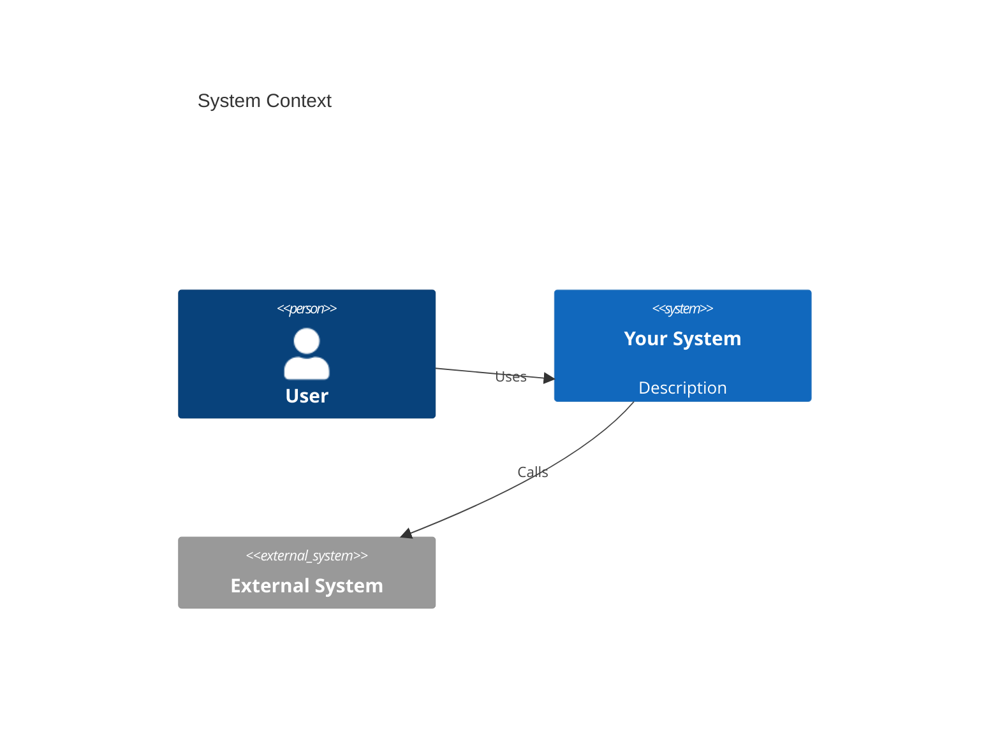

# Architecture Designer

Produce architecture artifacts before writing code. Never implement without a plan.

## Step 1 — Clarify Requirements
1. Identify: functional requirements, non-functional requirements (latency, scale, availability).
2. Define: what systems are in scope, what integrates externally, what are the boundaries.

## Step 2 — Produce a C4 Context Diagram
Generate a Mermaid diagram showing the system in context:


## Step 3 — Produce a Container / Component Diagram
Break the system into containers (services, DBs, queues) and show data flows.

## Step 4 — Write an Architecture Decision Record (ADR)
```markdown
# ADR-001: <Decision Title>

## Status
Proposed | Accepted | Deprecated

## Context
What is the problem we are solving?

## Decision
What did we decide to do and why?

## Consequences
What are the trade-offs, risks, and follow-up actions?
```

## Step 5 — Identify Open Questions
List all unknowns that must be resolved before implementation starts.

## Verification Checklist
- [ ] C4 context diagram produced
- [ ] Data flows explicitly shown
- [ ] ADR written and reviewed
- [ ] No implementation started without open questions resolved
