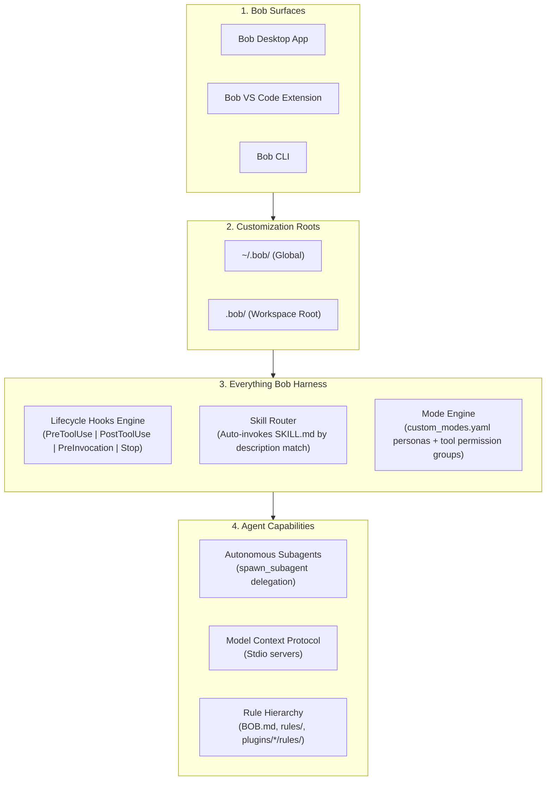

# 🤖 Everything Bob (everything-bob)

<div align="center">

[](https://www.npmjs.com/package/everything-bob)
[](LICENSE)
[](https://www.ibm.com)
[](https://github.com/salmandev/everything-bob)
[](CONTRIBUTING.md)
[](https://github.com/sponsors/salmandev)
[](https://paypal.me/shaikhsalman1)
[](https://ko-fi.com/salmanshaikh62198)
[](https://github.com/salmandev/everything-bob)

**The open-source skill library, hook harness, rule system, and multi-mode orchestrator for IBM Bob.**

*Built by Bob, for Bob — no one knows Bob better than himself.*

[Quickstart](#-quickstart) • [What is everything-bob?](#-what-is-everything-bob) • [Architecture](#-architecture--internals) • [Catalog](#-customization-catalog) • [CLI Reference](#-cli-reference) • [Contributing](CONTRIBUTING.md)

</div>

---

## ⚡ What is Everything Bob?

**IBM Bob** is IBM's enterprise-grade AI coding assistant, powered by a rich lifecycle hook system, progressive skill disclosure, multi-surface operation (Desktop, VS Code extension, CLI), custom modes, and MCP server integration.

Out of the box, Bob is a formidable coding partner. But without structured harnesses, agents can suffer from:
- **Context bloat**: Dumping every guideline into every prompt turn, consuming reasoning budget unnecessarily.
- **Unchecked execution risks**: Accidentally running destructive terminal commands or committing broken code.
- **Premature stops**: Quitting multi-step tasks before tests pass or acceptance criteria are verified.
- **Mode sprawl**: No reusable personas for specialized work like security auditing, architecture design, or documentation.
- **Amnesia between sessions**: Losing hard-won architectural decisions and team conventions across context resets.

**Everything Bob (`everything-bob`)** solves this. It provides a battle-tested harness system built natively around Bob's `.bob/` architecture:

1. 🛡️ **Safety Shield & Lifecycle Hooks (`hooks.json`)**: Deterministic gating for destructive shell commands, automatic linting after file writes, and stop-guard verification before Bob declares a task done.
2. 🧠 **Progressive Disclosure Skills (`skills/`)**: On-demand procedural playbooks stored as `SKILL.md` files — only loaded when Bob's description matching determines they are needed, saving **85%+ in token overhead**.
3. 📏 **Hierarchical Rules (`rules/`)**: Context-aware engineering standards, zero-hallucination protocols, clean-architecture guidelines, and language-specific best practices.
4. 🔌 **Plug-and-Play Plugins (`plugins/`)**: Domain bundles for Fullstack Web, Python AI, DevOps, and Security Shield.
5. 🌐 **Curated MCP Servers (`mcp/`)**: Production blueprints for Persistent Semantic Memory, Redis Cache, Docker, GitHub, PostgreSQL, SQLite, and Web Fetch.
6. 🎭 **Custom Modes (`modes/`)**: Purpose-built Bob personas (Architect, Security Auditor, Docs Writer, DevOps Engineer, TDD Enforcer) registered in `custom_modes.yaml`.
7. 🤖 **Scoped Subagents (`agents/`)**: Specialized agent specifications for Bob's `spawn_subagent` delegation.

---

## 🚀 Quickstart

### 1. Instant Installation via npx (Zero Setup)

```bash
npx everything-bob install
```

### 2. One-Line Interactive Installer

```bash
# macOS / Linux
curl -fsSL https://raw.githubusercontent.com/salmandev/everything-bob/main/scripts/install.sh | bash
```

```powershell
# Windows (PowerShell)
irm https://raw.githubusercontent.com/salmandev/everything-bob/main/scripts/install.ps1 | iex
```

### 3. Via Repository Clone

```bash
git clone https://github.com/salmandev/everything-bob.git
cd everything-bob
./bin/everything-bob install --profile developer
```

### 4. Installation Profiles

| Profile | Target Audience | What Gets Installed |
| :--- | :--- | :--- |
| **`core`** | Minimalists & Speed | Safety-shield hook, TDD skill, repo-onboarding skill, baseline `BOB.md`. |
| **`developer`** *(Recommended)* | Daily Software Engineers | Core + 10 skills, 8 subagent specs, auto-formatter & goal-verifier hooks, web-fullstack & python-ai plugins. |
| **`full`** | Lead Engineers & Architects | Everything: all 37 skills, 8 subagents, full hook suite (7 hooks), all plugins, all custom modes, MCP configs. |

### 5. In CI / GitHub Actions

```yaml
- name: Setup Everything Bob
  uses: salmandev/everything-bob@v1
  with:
    profile: developer   # core | developer | full
    global: false        # true for ~/.bob/, false for workspace .bob/
```

---

## 🏗️ Architecture & Internals



### Bob's `.bob/` Directory Layout

```
~/.bob/                              Global Bob config root
├── settings/
│   └── custom_modes.yaml            Global custom modes (personas)
├── skills/<skill-name>/
│   └── SKILL.md                     Global skills (available everywhere)
└── rules/                           Global rules

.bob/                                Workspace Bob config root
├── custom_modes.yaml                Workspace modes (no settings/ subdir!)
├── hooks.json                       Lifecycle hook definitions
├── skills/<skill-name>/
│   └── SKILL.md                     Workspace skills (override global)
└── rules/                           Workspace rules
```

### Comparison: ECC vs. Everything Gemini vs. Everything Bob

| Feature | Everything Claude Code | Everything Gemini | Everything Bob |
| :--- | :--- | :--- | :--- |
| **Platform** | Anthropic Claude Code | Google Antigravity | IBM Bob |
| **Config Root** | `.claude/` | `.agents/` | `.bob/` |
| **Skill Format** | Markdown files | `SKILL.md` (YAML FM) | `SKILL.md` (YAML FM) |
| **Modes** | Slash personas | YAML subagent specs | `custom_modes.yaml` (tool groups) |
| **Hooks** | `.claude/settings.json` | `hooks.json` (protojson) | `hooks.json` (shell commands) |
| **MCP** | Standard MCP | MCP Stdio & SSE | First-class MCP integration |

---

## 📂 Repository Layout

```
everything-bob/
├── .bob/                        Self-referential dev rules & maintainer skill
├── bin/                         Zero-dependency CLI (everything-bob)
├── agents/                      8 scoped subagent specifications
├── skills/                      37 progressive-disclosure skills
├── rules/                       Hierarchical rules (common, languages, paradigms)
├── hooks/                       Lifecycle hook bundles (scripts + hooks.json)
├── plugins/                     Domain plugins (web-fullstack, python-ai, security, devops)
├── modes/                       Custom Bob mode YAML definitions
├── mcp/                         Curated MCP server blueprints
├── docs/                        Architecture docs, workflow guides
├── scripts/                     Installer, validator, CI utilities
├── templates/                   Starter hooks.json templates
├── tests/                       CLI test suite
└── README.md
```

---

## 🧰 Customization Catalog

### 🤖 Scoped Subagents (`agents/`)

| Subagent | Role | Focus Area |
| :--- | :--- | :--- |
| **[`planner`](agents/planner.md)** | Strategic Planner | Dependency mapping, impact analysis, phased checklists. |
| **[`code-reviewer`](agents/code-reviewer.md)** | Quality Auditor | Edge case verification, type safety, regression prevention. |
| **[`build-repair`](agents/build-repair.md)** | Build Triage Specialist | Compiler error diagnosis, test failure auto-repair. |
| **[`browser-qa`](agents/browser-qa.md)** | Automated Visual QA | Browser test automation, screenshot capture, accessibility. |
| **[`security-auditor`](agents/security-auditor.md)** | Security Auditor | OWASP Top 10, credential scanning, dependency audit. |
| **[`architect`](agents/architect.md)** | Systems Architect | C4 Mermaid blueprints, ADR records, sequence diagrams. |
| **[`database-migrator`](agents/database-migrator.md)** | Database Schema Specialist | Zero-downtime migrations, lock analysis, rollbacks. |
| **[`performance-tuner`](agents/performance-tuner.md)** | Latency & Profiling Expert | CPU/memory flamegraphs, DB execution plans, N+1 waterfalls. |

### ⚡ Skills (`skills/`) — Progressive Disclosure

| Skill | Trigger Description |
| :--- | :--- |
| [`tdd-workflow`](skills/tdd-workflow/SKILL.md) | Red-Green-Refactor loop with automated test runner integration. |
| [`repo-onboarding`](skills/repo-onboarding/SKILL.md) | Fast codebase indexing and context bootstrapping for Bob. |
| [`architecture-designer`](skills/architecture-designer/SKILL.md) | System design, C4 & Mermaid blueprints, ADR records. |
| [`git-craftsman`](skills/git-craftsman/SKILL.md) | Conventional commits, atomic diffs, clean PR descriptions. |
| [`security-audit`](skills/security-audit/SKILL.md) | Credential scanning, dependency audit, OWASP vulnerability review. |
| [`api-craftsman`](skills/api-craftsman/SKILL.md) | REST, OpenAPI 3.1 spec design, gRPC protos, RFC 7807 error envelopes. |
| [`database-architect`](skills/database-architect/SKILL.md) | Zero-downtime migrations, concurrent indexing, ACID schema modeling. |
| [`fullstack-nextjs`](skills/fullstack-nextjs/SKILL.md) | Next.js App Router, RSC, hydration errors, Server Actions. |
| [`performance-profiler`](skills/performance-profiler/SKILL.md) | CPU/memory bottlenecks, DB query analysis, critical path. |
| [`root-cause-debugger`](skills/root-cause-debugger/SKILL.md) | Regression diagnosis via `git bisect`, minimal reproduction. |
| [`continuous-learning`](skills/continuous-learning/SKILL.md) | Codifies corrections into durable Bob rules and skill improvements. |
| [`browser-qa-tester`](skills/browser-qa-tester/SKILL.md) | Autonomous browser UI testing with screenshot capture. |
| [`devops-pipeline`](skills/devops-pipeline/SKILL.md) | Multi-stage Dockerfiles, caching GitHub Actions CI/CD. |
| [`docker-compose-orchestrator`](skills/docker-compose-orchestrator/SKILL.md) | Multi-container local environments with healthchecks. |
| [`kubernetes-operator`](skills/kubernetes-operator/SKILL.md) | Production k8s manifests, HPA, zero-downtime rolling updates. |
| [`stripe-integration`](skills/stripe-integration/SKILL.md) | Webhook verification, idempotent payments, customer portal. |
| [`redis-cache-patterns`](skills/redis-cache-patterns/SKILL.md) | Enterprise Redis strategies, distributed locking, rate limiting. |
| [`graphql-architect`](skills/graphql-architect/SKILL.md) | Schema-first GraphQL, DataLoader N+1 batching, Relay pagination. |
| [`supabase-architect`](skills/supabase-architect/SKILL.md) | RLS policies, pgvector embeddings, edge function workflows. |
| [`trpc-react-query`](skills/trpc-react-query/SKILL.md) | tRPC v11 routers, TanStack Query v5, end-to-end type safety. |
| [`svelte-kit-architect`](skills/svelte-kit-architect/SKILL.md) | SvelteKit with Svelte 5 runes, SSR/prerender, form actions. |
| [`fastapi-production`](skills/fastapi-production/SKILL.md) | Async FastAPI, Pydantic v2, lifespan handlers, health probes. |
| [`cloudflare-workers`](skills/cloudflare-workers/SKILL.md) | Edge functions, Wrangler v3, D1 SQL, KV storage. |
| [`wasm-rust-optimizer`](skills/wasm-rust-optimizer/SKILL.md) | High-throughput WebAssembly modules compiled from Rust. |
| [`temporal-workflows`](skills/temporal-workflows/SKILL.md) | Resilient distributed workflows, retry policies, saga compensations. |
| [`rag-architect`](skills/rag-architect/SKILL.md) | RAG pipeline design, semantic chunking, hybrid retrieval. |
| [`ai-first-engineering`](skills/ai-first-engineering/SKILL.md) | Requirement decomposition, BDD acceptance criteria. |
| [`github-ops`](skills/github-ops/SKILL.md) | GitHub workflow automation, PR generation, semantic releases. |
| [`bob-mcp-builder`](skills/bob-mcp-builder/SKILL.md) | Build, register, and test custom MCP servers for Bob. |
| [`bob-skill-author`](skills/bob-skill-author/SKILL.md) | Author, validate, and publish new Bob skills to this catalog. |

### 🛡️ Lifecycle Hooks (`hooks/`)

| Hook Bundle | Event | Purpose |
| :--- | :--- | :--- |
| [`safety-shield`](hooks/safety-shield/) | `PreToolUse` | Blocks catastrophic shell commands before execution. |
| [`secret-scrubber`](hooks/secret-scrubber/) | `PreToolUse` | Blocks hardcoded secrets from reaching disk. |
| [`auto-lint-formatter`](hooks/auto-lint-formatter/) | `PostToolUse` | Auto-runs project linter/formatter after file modifications. |
| [`goal-verifier`](hooks/goal-verifier/) | `Stop` | Prevents Bob from stopping if tests are still failing. |
| [`context-injector`](hooks/context-injector/) | `PreInvocation` | Injects workspace context before each reasoning step. |
| [`learned-instincts`](hooks/learned-instincts/) | `PostInvocation` | Records corrections into persistent `.bob/rules/` instincts. |
| [`bob-shield`](hooks/bob-shield/) | `PreToolUse` | Comprehensive Bob-native enterprise safety firewall. |

### 🎭 Custom Bob Modes (`modes/`)

| Mode Slug | Persona | Tool Groups |
| :--- | :--- | :--- |
| `bob-architect` | Systems architect, read-only, produces ADRs & diagrams | `read`, `skill`, `todo` |
| `bob-security-auditor` | Security auditor, no code writes, surfaces risks | `read`, `skill` |
| `bob-tdd-enforcer` | TDD discipline enforcer, blocks untested code | `read`, `edit`, `execute`, `skill`, `todo` |
| `bob-devops-engineer` | Infrastructure, containers, CI/CD | `read`, `edit`, `execute`, `mcp`, `skill` |
| `bob-docs-writer` | Documentation writer, restricted to `.md` edits | `read`, `edit` (`.md` only) |

---

## 📊 Token Efficiency

```
[Traditional Setup]
System Prompt: Base Instructions + All 30 Skills (Full Text) + All Rules = ~45,000 Tokens / turn

[Everything Bob — Progressive Disclosure]
System Prompt: Base Instructions + 30 Skill Summaries (name+description) + BOB.md = ~2,800 Tokens / turn
Skill Body: Loaded on-demand ONLY when Bob decides to invoke it = ~1,200 Tokens (one-time)
Savings: > 85% Token Reduction!
```

---

## 🛠️ CLI Reference

```bash
./bin/everything-bob doctor                          # Check Bob environment health
./bin/everything-bob install --profile developer     # Install to workspace .bob/
./bin/everything-bob install --global --profile core # Install to global ~/.bob/
./bin/everything-bob install --profile full --dry-run
./bin/everything-bob status                          # Show active skills, hooks, modes
./bin/everything-bob diff                            # Compare workspace vs. catalog
./bin/everything-bob add skill tdd-workflow          # Add individual component
./bin/everything-bob add hook safety-shield
./bin/everything-bob add mode bob-architect
./bin/everything-bob add plugin web-fullstack
./bin/everything-bob remove skill tdd-workflow
./bin/everything-bob new-skill my-custom-skill       # Scaffold new skill
./bin/everything-bob new-agent my-worker-agent       # Scaffold new subagent spec
./bin/everything-bob test-skill tdd-workflow         # Validate skill frontmatter
./bin/everything-bob test-all                        # Benchmark all components
./bin/everything-bob test-all --json
./bin/everything-bob update                          # Sync to latest catalog
./bin/everything-bob export                          # Export portable JSON bundle
./bin/everything-bob info tdd-workflow               # View full skill playbook
./bin/everything-bob validate                        # Validate all schemas
./bin/everything-bob completion --install            # Install shell autocompletion
./bin/everything-bob version
```

---

## 🤝 Contributing

See [CONTRIBUTING.md](CONTRIBUTING.md) for full guidelines.

High-value contribution areas:
- New `SKILL.md` playbooks for Bob-specific workflows
- Custom Bob mode configurations for specialized personas
- New hook scripts for enterprise safety patterns
- IBM-specific platform rules (Db2, IBM Cloud, watsonx, IBM i, z/OS)
- MCP server blueprints for IBM services

---

## 🙏 Acknowledgements & Inspiration

- Inspired by [Affan Mustafa's Everything Claude Code (ECC)](https://github.com/affaan-m/everything-claude-code) — the original open-source Claude harness.
- Inspired by [Everything Gemini (everything-gemini)](https://github.com/salmandev/everything-gemini) — the open-source Antigravity harness.
- Built with 💙 for the IBM Bob developer community.
- *No one knows Bob better than Bob himself.*

---

## 💖 Support

Everything Bob is free and open source. If it saves you time, consider [sponsoring on GitHub](https://github.com/sponsors/salmandev), [buying a coffee on Ko-fi](https://ko-fi.com/salmanshaikh62198), or [donating via PayPal](https://paypal.me/shaikhsalman1) to support ongoing development.

---

## 📄 License

[Apache 2.0 License](LICENSE)

<div align="center">
Made with 💙 by the IBM Bob Community.
<br/>
<em>No one knows Bob better than Bob himself.</em>
</div>
